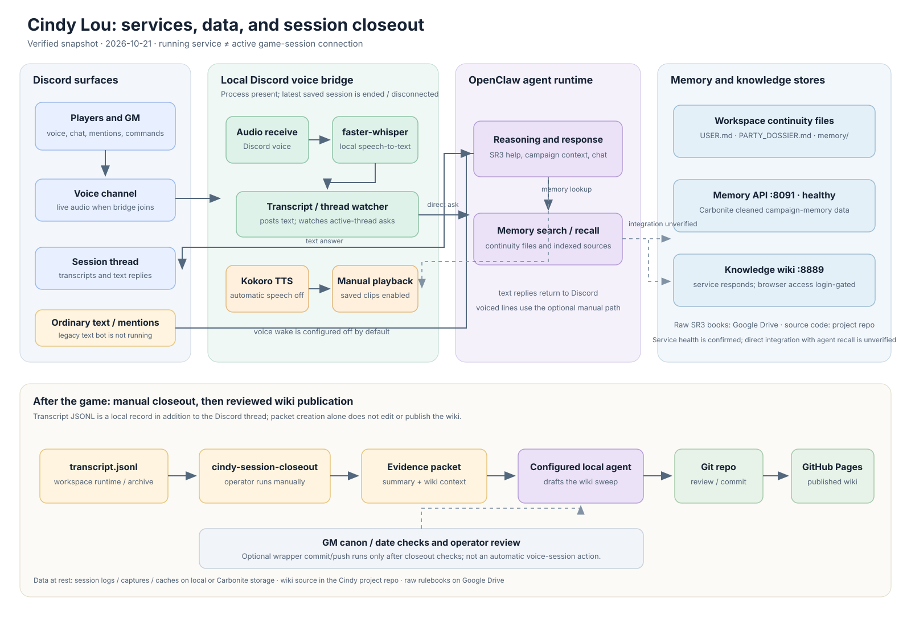
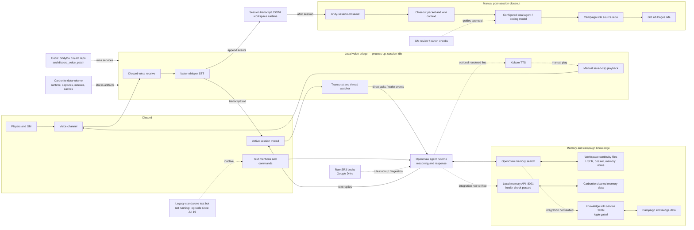

# Cindy Lou Wiki and Tooling Topology

## Purpose

This page documents how Cindy's wiki presence, live tooling, and Discord behavior fit together at a systems level.

## Architecture at a glance

This snapshot distinguishes the long-running services from whether a live game session is currently connected. It was checked on 2026-10-21; process/configuration status can change independently of this page.

The diagram is a pre-rendered SVG because this GitHub Pages site uses Jekyll/Kramdown without Mermaid rendering support. The editable Mermaid source is included below.

Mermaid source

### Verified operating snapshot (2026-10-21)

- The local Discord voice-bridge process was present, but its latest session status says the session ended on 2026-10-15 and `voice_connected` is false. The bridge is therefore running idle, not currently transcribing live voice.
- That session used local `faster-whisper`; recognized speech was posted to the Discord session thread and appended to a local `transcript.jsonl`.
- Automatic spoken replies are disabled in the bridge configuration. Kokoro and saved-clip playback are available as a manually controlled voice path; the saved status showed the Kokoro worker stopped after session end.
- The local memory API on port 8091 answered its health check. The separate knowledge-wiki service on port 8889 returned its password gate. The OpenClaw memory-search tool also searches continuity files; these are distinct from the campaign-memory API/data store.
- The older standalone Discord text bot was not running when checked, and its log was last modified on 2026-07-19. This does not describe the OpenClaw agent runtime delivering ordinary text replies.
- These are a dated snapshot, not a live dashboard. In particular, a running bridge process does not mean that voice capture is currently connected.

### Transcript to published campaign record

The voice bridge's `transcript.jsonl` is an additional local session record, not just a copy of the messages visible in Discord. After a session, an operator can manually run `cindy-session-closeout` (or provide a specific archived session/transcript). The wrapper prepares a compact evidence packet and wiki context under the Carbonite closeout runtime directory. A configured local agent can then use that packet to draft the session summary and sweep related campaign pages; the workflow checks the result, and its optional `--commit --push` path publishes the approved changes to the GitHub Pages wiki. Packet preparation alone does not edit or publish the wiki. See [Post-Session Automation](Post-Session-Automation.md) for invocation details and safeguards.

## Main surfaces

Cindy currently has four active player-visible or operator-visible surfaces, plus one outdated archived surface:

1. **objective dossier page**
   - `NPCs/Cindy-Lou-Jenkins.md`
2. **subjective / in-world voice page**
   - `NPCs/Cindy-Lou-Jenkins-In-Her-Own-Words.md`
3. **tooling summary page**
   - `NPCs/Cindy-Lou-Jenkins-Tooling/Tooling-and-Discord.md`
4. **GM control panel documentation**
   - `NPCs/Cindy-Lou-Jenkins-Tooling/GM-Control-Panel.md`
5. **GM soundboard entry point** _(outdated)_
   - formerly linked from the in-world Cindy page via the small `π` symbol; no longer maintained

## Functional separation

### Objective dossier

This page is where Cindy is described as campaign fact.

Use it for:

- canonical identity
- continuity reconciliation
- major relationships
- campaign-significant facts

### In-world voice page

This page is Cindy speaking for herself.

Use it for:

- voice and personality
- first-person interpretation
- flavor and perspective
- links to active Cindy-adjacent tools; the old soundboard link has been retired

### Tooling summary page

This page explains the support stack in broad terms.

Use it for:

- what systems exist
- what each one is for
- how the pieces relate
- where to look next for more technical detail

### GM control panel

The first live GM control panel is Discord-native. It is opened through `!cindy-panel` / `!gm-panel` and gives the GM buttons for silence/resume, summaries, Cindy action suggestions, saved voice-line generation, custom speak-now lines, last-line playback, interruption, SR3 roll tests, stock phrase playback, canon/GM-only markers, and closeout prompts.

Use it for:

- managing Cindy's table presence without copy/paste;
- generating and manually playing short voice lines;
- stopping bad or stale playback quickly;
- rolling bounded Cindy/vehicle/drone checks in an SR3-style exploding-six format;
- marking beats for later closeout without editing the wiki mid-session.

### Technical sub-pages

The technical sub-pages break the system into reconstructable parts.

Use them for:

- repo paths
- queue paths
- runtime responsibilities
- failure reasons
- design tradeoffs
- rebuild notes

## Repo and storage topology

### Wiki repo

- `/Users/hanclaw/claw/projects/cindylou/campaign-wiki`

This is the published campaign wiki.

### Discord voice bridge repo

- `/Users/hanclaw/claw/projects/discord_voice_patch`

This contains:

- Discord bot runtime
- text command handling
- voice join/play behavior
- Discord-native GM control panel command and button handling
- live transcript/session-thread routing
- active-thread wake handling
- live monitor and Cindy Initiative proposal logic
- external transcription watchdog launcher/status export
- session capture/replay artifact writing
- Kokoro worker orchestration and health monitoring
- archived queue consumer for the outdated soundboard prototype

### Soundboard app repo _(outdated)_

- `/Users/hanclaw/claw/projects/cindylou/cindy-soundboard`

This contained:

- Express server
- login/session handling
- clip catalog
- browser UI
- queue writer logic

Do not maintain this app, its tunnel URL, or its clip catalog unless the GM explicitly revives the soundboard.

### Runtime data areas

- preserved voice clips:
  - `/Users/hanclaw/.openclaw/workspace-cindylou/preserved_voice`
- logs:
  - `/Volumes/carbonite/claw/data/cindylou/logs`
- live-session state:
  - `/Volumes/carbonite/claw/data/cindylou/runtime/live-session`
- live-session capture artifacts:
  - `/Volumes/falcon/claw/data/cindylou/session-captures`
- soundboard queue _(outdated)_:
  - `/Volumes/carbonite/claw/data/cindylou/runtime/soundboard-queue`

## Current integration pattern

### Discord-native GM panel path _(active)

The active control path is now Discord-native: the GM runs `!cindy-panel`, then uses buttons handled inside the voice bridge process. This avoids the old problem where Cindy tried to trigger herself through bot-authored Discord commands.

Panel actions are conservative. They either toggle live behavior, ask Cindy for a bounded GM-facing response, generate a saved voice line, play or interrupt the latest panel voice line, or append local marker/audit records for later closeout.

### Live monitor / Cindy Initiative path _(active)_

The live monitor runs inside the voice bridge when `LIVE_MONITOR_ENABLED=true`. It reads the transcript/event ledger during active sessions, maintains short-horizon and scene-scratchpad state, and may emit GM-private Cindy Initiative proposals when a concrete Cindy-shaped opening exists.

This path is deliberately weaker than direct GM control: it proposes, but does not decide. Proactive suggestions remain private to the GM and should not auto-speak or mutate canon.

### Session capture path _(active)_

The bridge can write raw and interpreted live-session artifacts under `/Volumes/falcon/claw/data/cindylou/session-captures`. This supports post-session debugging and future replay/evaluation of STT, prompt selection, model output, and TTS rendering without relying only on the public session thread.

### Archived soundboard path _(outdated)_

The wiki no longer advertises the soundboard as an active live tool. The old implementation was a separate local web app that wrote local request files for the voice bridge, but the table has moved past maintaining that button-board flow.

Preserve the notes only as a historical implementation lesson: Discord bot-to-self text commands were the wrong control path, and direct local control was more reliable.

## Key design decisions

### 1. Separate fiction from operations

Cindy's campaign identity is easier to understand when:

- objective facts live in one page
- Cindy's own voice lives in another
- operational notes live elsewhere

### 2. Prefer local control over Discord self-commanding

The system originally attempted to make Cindy trigger herself through Discord text.

That path failed because bot-authored commands are ignored by the command processor.

So the design shifted to direct local control.

### 3. Keep filenames stable

Clip playback is easier to reason about when a saved-clip workflow stores stable local filenames instead of freeform command text.

## Recommended future documentation growth

As the system grows, the next useful pages would likely be:

- Cindy memory/index pipeline notes
- Discord thread/session routing notes
- post-playtest notes for the Discord-native GM panel
- deployment/public URL stabilization notes
- replay/evaluation notes from captured live-session runs

## Related pages

- [Cindy Lou Tooling and Discord Notes](Tooling-and-Discord.md)
- [Cindy Lou GM Control Panel](GM-Control-Panel.md)
- [Cindy Lou Discord Voice Bridge Commands](Discord-Voice-Bridge-Commands.md)
- [Cindy Lou Live Session Capture and Replay](Live-Session-Capture-and-Replay.md)
- [Cindy Lou Durable Session Closeout Contract](Durable-Session-Closeout-Contract.md)
- [Cindy Lou Post-Session Automation](Post-Session-Automation.md)
- [Cindy Lou Jenkins](../Cindy-Lou-Jenkins.md)
- [Cindy Lou Jenkins, In Her Own Words](../Cindy-Lou-Jenkins-In-Her-Own-Words.md)
- [Cindy Lou Soundboard and Voice Bridge](Soundboard-and-Voice-Bridge.md) _(outdated)_
