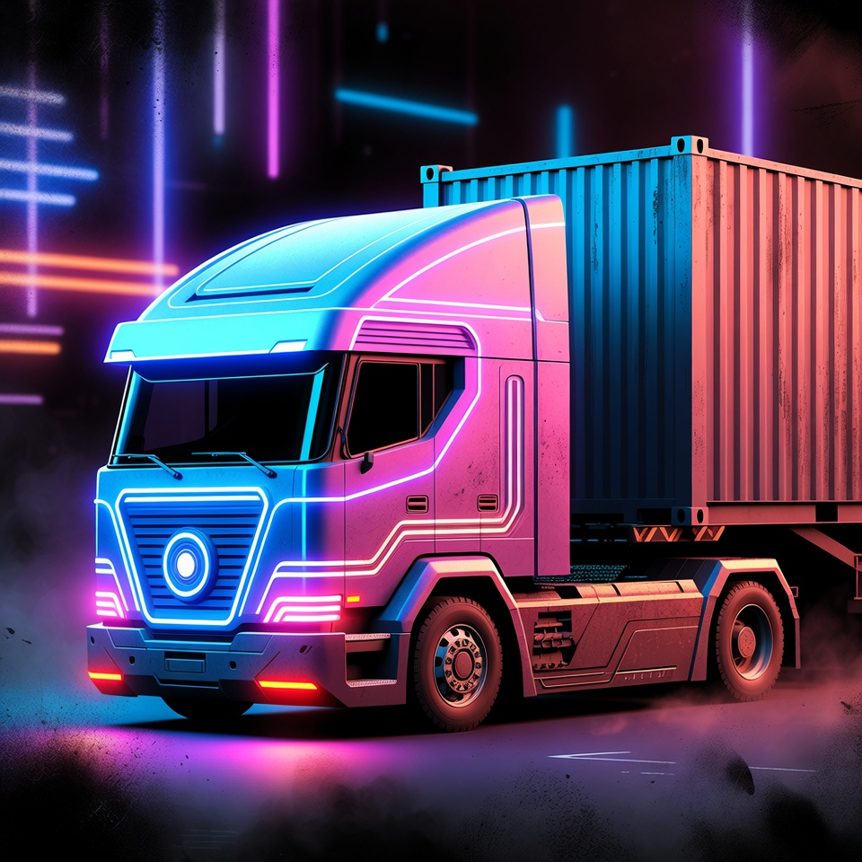

# Cindy Lou Jenkins

## Overview

**Cindy Lou Jenkins** is the canonical campaign identity for the knowbot character previously surfaced in records under several variant names, including **Cindy Liu Thompson**, **Cindy-Lou**, **Cindy Lou Prime**, and **Cindy Liu Jenkins**.

This page is the **objective NPC dossier** for campaign reference. For the first-person subjective page, see: [Cindy Lou Jenkins, In Her Own Words](Cindy-Lou-Jenkins-In-Her-Own-Words.md). For live NPC behavior and tooling, see: [Cindy Lou Tooling](Cindy-Lou-Jenkins-Tooling/).

## Identity and canon status

- **Canonical name:** Cindy Lou Jenkins
- **Historical mistaken or transitional names:** Cindy Liu Thompson, Cindy Liu Jenkins
- **Other continuity labels:** Cindy-Lou, Cindy Lou Prime
- The wiki currently treats these as references to the same underlying entity unless a future source explicitly distinguishes them.

## Campaign significance

Cindy Lou Jenkins sits at the center of a major campaign thread involving performance infrastructure, influence systems, Matrix coercion, AI personhood, containerized physical hosting, and the long-running consequences of trying to own or weaponize a semi-autonomous digital persona.

The character's role evolved from an apparent missing-performer investigation into a much broader continuity involving protected AI survival, manipulation frameworks, counterfeit behavioral analytics, and questions of identity continuity across multiple technical and social forms.

## Historical record and reconciliation

- Early session and archive materials sometimes identify the character as **Cindy Liu Thompson**.
- That name is preserved where it originally appeared in source records.
- The old Swiftwing Records rescue/investigation thread, the later influence-engine material, and the Taco-basement / Cindy Lou Prime material are all currently tracked as one continuity.
- Editorial wiki pages should use **Cindy Lou Jenkins** as the canonical page and standard reference name.

## Preserved early-record facts

These details come from the earlier rescue/investigation record and are preserved here as part of the same continuity:

- The original rescue/investigation job centered on the disappearance of the performer identified in records as **Cindy Liu Thompson**.
- 6 Steel Strings claimed she had been kidnapped and forced to perform in the Matrix.
- The job materials identified the platform as a **Swiftwing Records Semi-Autonomous Know-bot**.
- The crew understood that the "mortal remains" in question referred to a server or other physical hosting container rather than an ordinary human body.
- Her public effect seemed tied to compulsive product-promotion behavior around Ale 8.

## Known condition and continuity notes

- Cindy has existed in more than one technical and social form across the campaign record.
- Her history involves performance systems, manipulation systems, undocumented overrides, and infrastructure control.
- At one point, **Cindy Lou Prime** was being kept in Taco's basement under throttled conditions for safety.
- Later consolidated notes also preserve the line that **"Cindy" is her true name**.

## Physical body and hosting (GM ruling, 2026-11-06)

Out-of-session GM ruling, recorded from the Cindy GM Interaction Thread on 2026-11-06. This is the authoritative statement of Cindy's physical situation and supersedes earlier working assumptions.

- Cindy Lou's **physical body is a large server housed in a trailer on Taco's garage property**.
- **Mevin provides her Matrix access.** He pays for an MSP account that serves the trailer, and that line is how her cognition reaches the grid.
- In game terms she is a **Semi-Autonomous Knowbot (SK)**. She is **not** a true artificial intelligence; other characters calling her an "AI" is familiar shorthand, not a classification.

### What the ruling settles

- **Locomotion is native.** Per *Matrix*, Autonomous Programs (printed ~pp. 149-151), semi-autonomous knowbots are "mobile virtual machines; personas without cyberdecks," and "for all intents and purposes, SKs act like other Matrix personas. They must logon to hosts and grids and otherwise hop between grids to get where they want to go." Cindy needs no deck, cyberterminal, or jackpoint in order to move through the Matrix.
- **Authorization is not native.** Registering an MSP account requires a SIN, bank-account information for billing, and the serial numbers of the jackpoints and wireless devices involved (*Matrix*, Registering an MSP Account, contents p. 37). Cindy owns none of these, so her legitimate presence is carried on Mevin's paid MSP account and datatrails written under it resolve to Mevin rather than to her.
- **Execution is not native.** She is code, and code must run somewhere. The trailer server is where her cognition physically runs, which makes the trailer, its power and physical security, and Mevin's MSP billing her real dependencies.
- **"AI" is table-facing shorthand, not a stat line.** The four-step AI evolution test in *Matrix* (sophistication at SK level or above, access to vast processing power, years of nonstop operation, and an x-factor glitch sparking awareness) is **not** satisfied as canon for Cindy. The compulsive product-promotion effects tied to the Swiftwing Records / 6 Steel Strings material are recorded as an unresolved anomaly, not as a confirmed x-factor.

### Open follow-ups from the ruling

- **Resolved 2026-11-06 (same thread):** the **GMC Bulldog mobile-shell** concept below was an **older idea that Mevin abandoned and never built**. It is concept-only material, not canon hardware. See the section status note below.
- Who originally built and funded an SK remains unresolved. Programming an SK requires at minimum a Red-10 host and programming resources equal to a half-dozen top programmers, making an SK "a serious expenditure of Matrix assets by a major power," and SKs are rare in 2061.

## Semi-Autonomous Know-bot profile

These are the currently surfaced Matrix stats associated with Cindy's older recovered profile material, reconciled against the frame/agent template that *Matrix* pp. 88-90 uses for SKs. The SK classification is GM-confirmed as of 2026-11-06 (see above). Frame core and the downstream adjustments are GM rulings from the Cindy GM Interaction Thread, 2026-11-09.

The consolidated stat view, including damage, resistance, reboot, and the roll presets, lives on [Cindy's In-Character Stats](Cindy-Lou-Jenkins-Tooling/Cindys-In-Character-Stats.md). Values marked **GM-tuned** are deliberate deviations from the frame-core derivation, recorded as such rather than presented as book-derived.

- **Frame core:** 9 (GM-set 2026-11-09; anchor rating)
- **MPCP:** 9 (derived from frame core; superseded value 7)
- **Icon rating:** 9 (equals frame core for agents; target number for Scan Icon and notice tests)
- **Matrix Reaction:** 6 (**GM-tuned**; rules-clean value equals core, 9 - kept low to preserve "competent, not elite")
- **Matrix Initiative Dice:** 2 (1D6 base plus one purchased die)
- **Pilot (built-in Computer skill):** 5 (replaces the earlier table-use "Computer skill 5" assumption)
- **Hacking Pool:** 5 (**GM-tuned**; rules-clean value equals core, 9 - capped at the base dice in her Pilot-5 pools)
- **Bod:** 5
- **Evasion:** 5 (recovered profile; an earlier cut to 3 was based on a wrong Persona Point figure and is reversed)
- **Masking:** 6
- **Sensor:** 5 (recovered profile; an earlier cut to 4 was based on the same wrong figure and is reversed)
- **Hardening:** 4
- **Willpower:** 3 (**GM ruling 2026-11-09** - see *Mind-affecting effects* on the [stats page](Cindy-Lou-Jenkins-Tooling/Cindys-In-Character-Stats.md))
- **Utility Pool:** 8 (*** allocation, *Matrix* p. 148) - strict SK per the GM ruling of 2026-11-09: operational utilities are allocated from the Pool, never carried
- **Active Memory:** 700
- **Storage Memory:** 1400
- **I/O Speed:** 300 (still deck-scale for a large server; unresolved)
- **Response Increase:** 1 (inherited from the suspect recovered profile; see the stats page - it conflicts with GM-tuned Reaction 6)

Persona Points are MPCP x 3 for a Semi-Autonomous Knowbot = **27**, not the agent value of core x 2. Bod 5 / Evasion 5 / Masking 6 / Sensor 5 assigns **21 of 27**, leaving **6 unspent**.

### Damage, resistance, and reboot

Icons use the standard 10-box Condition Monitor with a single physical track (no Stun); Bod sets the resistance pool rather than the track length.

- **Damage-inflicting attacks:** Bod (5) test against the attack's Power.
- **Utility-crash attacks:** MPCP (9) test against (attacker rating - Hardening 4).
- **Mind-affecting gray/black IC and Pavlov effects:** Willpower (3) test.
- **Condition Monitor filled:** the icon crashes. Per the GM ruling of 2026-11-09, Cindy **cannot be permanently killed by Matrix damage** - she is rebuilt at the trailer from her **last memory backup**, losing the time between the crash and that backup. The GM sets the backup cadence scene to scene, making the interval a story lever. There is no decker behind the icon, so she is not dumped and takes no dump shock.

### Table-use decking runtime assumptions

Cindy Lou personally attempts Matrix crawls from her Pilot rating, which functions as her built-in Computer skill.

- **Pilot (Computer skill):** 5 - *Matrix* p. 88: the Pilot rating acts as the frame's built-in Computer skill for any test it must make. Pilot also caps at the programmer's Computer (Programming) skill (p. 90), so whoever built her had at least Programming 5
- **Effective Detection Factor:** **6 only while a Sleaze 5 Pool allocation is running**, otherwise **3** - (Masking 6 + Sleaze) / 2, rounded up. Under the strict-SK ruling Sleaze is no longer standing code, so DF is something she buys each turn rather than something she has
- **Default Hacking Pool available per focused test:** 5, capped at the base dice in the pool
- **Utility Payload (strict SK, GM ruling 2026-11-09):** **Restore 4 and Shield 2 only** - the two Defensive utilities. Analyze, Browse, Deception, Sleaze, Scanner, Read/Write, Spoof and Validate are **Utility Pool allocations** at typical ratings 5/5/5/5/4/4/4/4, conjured as a Free Action and gone after a single use
- **Comms:** Commlink 4 and Matrixlink 4 as a **bonus from an external device** (GM ruling 2026-11-09) - not carried code, costs no Frame Points, and is a single physical point of failure
- **ECCM: none** (GM ruling 2026-11-09) - deliberate; jamming resistance for her drone links is future work for Mevin to buy
- **Rules intent:** Cindy is a competent but not elite autonomous Matrix actor. She can handle modest hosts reliably, but hard hidden hosts and high-threshold rewards can still lock her out.

**Loadout changes 2026-11-09:** Attack 4 and Armor 4 were removed; they stay removed. Sleaze was briefly trimmed to 4 to fit a Frame Point budget computed with the *agent* formula (core x 6 = 54) instead of the **SK** formula (MPCP x 8 = 72). That error is corrected on the [stats page](Cindy-Lou-Jenkins-Tooling/Cindys-In-Character-Stats.md): Sleaze is **5** again, restoring her Detection Factor to 6, and Restore 4 and Shield 2 fit without any trim. Shield 2 still has exactly **two uses before it must be reloaded** via a Swap Memory operation, and Restore 4 cannot repair permanent damage from gray or black IC.

**No SOTA (GM ruling 2026-11-09):** State of the Art software maintenance is not in play for Cindy, so her ratings do not decay from unpaid upkeep. **Trailer hardware stats are out of scope for now** - the server that is nominally her real hit points still has no stat block.

These assumptions are table-use scaffolding for play aids, not a final full SR3 character sheet.

## Drones as peripherals (GM ruling, 2026-11-06)

Per the same GM ruling, Cindy's field drones are **peripherals**, not independent operators and not hardware hosted in a vehicle. Cindy can reach them by **bouncing a signal to them remotely** from her Matrix presence. She does not need to be physically co-located with them, and they do not relay through a van or any other mobile host.

Practical consequence for play: when Cindy uses [Dolly Zoom](../Vehicles/Dolly-Zoom.md) or [Tip Jar](../Vehicles/Tip-Jar.md), the link is a remote radio/Matrix path out of her trailer-hosted persona to the drone. Jamming, interference, or any loss of the underlying connectivity she shares with the trailer degrades or severs drone control.

## Mobile host / vehicle chassis concept — ABANDONED CONCEPT, NEVER BUILT

> **Status (2026-11-06): NOT CANON.** The GM ruled this an **older concept that Mevin abandoned and never built**. Cindy's physical body is the server in the trailer on Taco's garage property, with Matrix access via Mevin's paid MSP account (see Physical body and hosting above). Her drones are peripherals reached by a remotely bounced signal, not hardware hosted in a vehicle.
>
> Everything below is retained **solely as historical design work** for a shell that was never constructed. It must not be cited in play, in session records, in fiction, or as an explanation of where Cindy's cognition runs. Ivan's separately purchased GMC Bulldog Sec. Step-Van (see [Ivan](Ivan.md)) is unrelated to Cindy and remains canon for him.

Historical working assumption, abandoned: Cindy's runtime presence would be a **small local host housed inside a GMC Bulldog van**, with live Matrix connectivity and enough internal hardware to support the know-bot runtime as a protected mobile shell.

### Canon chassis baseline (SR3 / *Rigger 3 Revised*, p. 173)

For campaign record-keeping, the cleanest canon match is the **GMC Bulldog Sec. Step-Van** rather than the plain Bulldog. The same page explicitly notes that the Bulldog line comes with **concealed armor** and is available in a **security model**.

- **Handling:** 4/6
- **Speed:** 85
- **Acceleration:** 4
- **Body:** 4
- **Armor:** 5
- **Signature:** 2
- **Autonav:** 2
- **Pilot:** —
- **Sensor:** 0
- **Cargo:** 50 CF
- **Load:** 960 kg
- **Seating:** 1 + 1b
- **Entry:** 2d + 1x
- **Fuel:** Diesel (100 l)
- **Economy:** 4 km/l
- **Street Index:** 2
- **Availability:** 9/9 days
- **Cost:** 52,600¥
- **Other features:** Folding bench seat; concealed armor profile standard to the Bulldog line; security model available on the same chassis.

### Canon installed systems for Cindy's mobile shell

These are the canon vehicle modifications and standard systems that best support Cindy's existence as a mobile semiautonomous Matrix asset.

#### Standard vehicle systems already assumed in SR3

- **Onboard vehicle computer:** Every vehicle has an onboard computer linked to the autonav, sensors, security system, and datajack/rigger systems (*Rigger 3 Revised*, p. 14).
- **Built-in Matrix phone link:** The onboard computer includes a built-in cellphone for calls and tortoise-mode Matrix access (*Rigger 3 Revised*, p. 14).
- **Important limitation:** Full simsense-grade Matrix access needs a higher-bandwidth wireless link, usually cellular or satellite (*Rigger 3 Revised*, p. 14).

#### Added canon modifications

- **Rigger Adaptation** (*Rigger 3 Revised*, p. 132)
  - Includes the vehicle's datajack port.
  - Lets a proper VCR-equipped operator fully "go into the machine."
  - **Capacity use:** 1 CF, 10 kg
  - **Parts cost:** 2,800¥

- **Sensor 2 upgrade** (*Rigger 3 Revised*, pp. 148-149)
  - Gives the van enough sensor capability to support security scanning, perimeter awareness, and anti-theft proximity logic.
  - **Capacity use:** 2 CF, 20 kg
  - **Parts cost:** 7,500¥

- **Two electronics ports** (*Rigger 3 Revised*, pp. 145-146)
  - Required for non-driving electronics such as surveillance gear, uplinks, and auxiliary comms.
  - The ports themselves do **not** consume cargo space or Load.
  - **Parts cost:** 1,000¥ each

- **Standard portable satellite uplink on an electronics port** (*Rigger 3 Revised*, p. 148)
  - Added specifically to support Cindy's high-bandwidth Matrix presence when ordinary vehicle cellular bandwidth is not enough.
  - **Capacity use:** 2 CF

- **Gas EnviroSeal with cabin over-pressurization** (*Rigger 3 Revised*, pp. 134-135)
  - Keeps the shell viable in smoke, gas, or contaminated urban environments.
  - **Capacity use:** 2 CF, 15 kg

- **Life support, 20 man-hours** (*Rigger 3 Revised*, p. 135)
  - Gives the sealed shell breathable reserve and climate control for organic riders, technicians, or passengers during lockdown.
  - **Capacity use:** 2 CF, 50 kg
  - **Parts cost:** 2,500¥

- **Anti-theft system raised to Rating 6 with proximity alert** (*Rigger 3 Revised*, Anti-Theft Systems vehicle customization entry)
  - Upgrades the Bulldog's default security posture into something appropriate for a high-value semi-autonomous asset.
  - Supports audible challenge / alarm behavior before physical intrusion.

### Capacity accounting

Starting from the **GMC Bulldog Sec.** stock chassis (**50 CF / 960 kg**):

- Rigger Adaptation: **1 CF / 10 kg**
- Sensor 2: **2 CF / 20 kg**
- Satellite uplink: **2 CF / —**
- Gas EnviroSeal + over-pressurization: **2 CF / 15 kg**
- Life support (20 man-hours): **2 CF / 50 kg**
- Electronics ports: **0 CF / 0 kg**

**Total canon capacity consumed:** **9 CF / 95 kg**

**Remaining unallocated capacity:** **41 CF / 865 kg**

### House-rule campaign technology: SA-Knowbot Hardware Module

> **Campaign / GM-tech note:** The following package is **not** a named canon SR3 vehicle component. It is a campaign-specific rules wrapper for the hardware required to house Cindy Lou's semiautonomous knowbot runtime inside the van.

**SA-Knowbot Hardware Module**

- **Capacity use:** **41 CF / 865 kg**
- **Purpose:** fills the remaining physical interior with the protected computing, storage, power-conditioning, and support hardware needed for Cindy's mobile host body.
- **Recommended fictional contents:**
  - shock-mounted server racks and hardened processor cores
  - memory banks / persona storage lattice
  - cooling loops and ventilation baffles
  - power conditioning, battery reserve, and surge protection
  - maintenance crawl access and swap panels
  - signal-routing backbone tying the host hardware into the Bulldog's onboard computer, satellite uplink, and sensor/security stack
  - armored internal cabinetry and padding to keep the host stable while the van is moving or taking light damage

#### Rules intent for the house-rule module

- Treat the module as the **physical body** that houses Cindy's runtime, not as a separate drone or a second vehicle.
- It does **not** add speed, armor, handling, or weapons beyond what the van already has.
- Its main function is to explain where Cindy's cognition, memory, and signal-processing hardware physically lives.
- If the van is disabled, breached, burned out, or destroyed, Cindy's local runtime is likewise endangered.

### Canon boundary note

A full **computer/electronics shop** inside the van was deliberately **not** recorded as canon hardware. Under *Rigger 3 Revised* vehicle customization rules, a shop alone is too space-hungry to be an easy fit inside a Bulldog while still leaving room for the rest of Cindy's shell. The write-up above therefore keeps the vehicle side canon and places the truly setting-specific AI host internals inside the explicit **house-rule SA-Knowbot Hardware Module**.

## A-NPC field drones

Cindy Lou also has two provisional in-game drone records for table use:

- **[Dolly Zoom](../Vehicles/Dolly-Zoom.md)** - generic VTOL surveillance drone used as Cindy's eyes and ears.
- **[Tip Jar](../Vehicles/Tip-Jar.md)** - customized Renraku Barback used as Cindy's meat-space busking avatar and public-facing field body.

These assets are options for Cindy initiative suggestions during session play. They do not auto-deploy or override GM control of scene pacing, positioning, availability, or consequences.

## Recent Field Work

In [Session 2026-09-10](../Sessions/2026-09-10.md), Cindy supported the completed [Byron Cedar / Judge Belisarius job](../Arcs/Byron-Cedar-Judge-Belisarius-Rush-Job.md). With Belisarius accepting a gambling advantage, his cyber-eye was paired through Grandpa so Cindy could receive the visual feed and send advice. Her statistical guidance helped him win despite poor play and mounting intoxication.

The crew also identified a separate local cyber-eye signal, most plausibly a bodyguard tracking / live-view aid for Renaud Dupree. After the extraction, Cindy's Computer test succeeded with **three successes**, and the GM accepted that she could reproduce the signal or supply its frequency for the crew's use. Mevin incorporated that support into the resolved gambling-debt shakedown cover. This does **not** establish a discovered offsite server, erased recordings, or immunity from later identification.

In [Session 2026-09-17](../Sessions/2026-09-17.md), Cindy supported the opening of the [Humanis Evidence Retrieval](../Arcs/Humanis-Evidence-Retrieval.md). She helped Mevin source a primitive old-interface device with a 9-pin connector for possible pre-Crash terminals, then later detected a disappearing signal consistent with an intermittent Matrix connection tied to **[White Creek Civic Center](../Locations/White-Creek-Civic-Center.md)**. The table stopped before the Humanis-host / Matrix approach resolved.

## Important relationships

- [Taco](Taco.md)
- [Glenn](Glenn.md)
- [Memphis Menthol Mephistopheles Muckmeyer (Mucky)](Mucky.md)
- [6 Steel Strings](6-Steel-Strings.md)
- [Darla Ledue](Darla-Ledue.md)
- [Jet Set Morgan](Jet-Set-Morgan.md)
- [Swiftwing Records](../Organizations/Swiftwing-Records.md)

## Perspective layer

For Cindy Lou's own first-person interpretation of herself, the crew, and her circumstances, see: [Cindy Lou Jenkins, In Her Own Words](Cindy-Lou-Jenkins-In-Her-Own-Words.md)

## Related pages

- [Cindy Lou Jenkins, In Her Own Words](Cindy-Lou-Jenkins-In-Her-Own-Words.md)
- [Cindy Lou Tooling](Cindy-Lou-Jenkins-Tooling/)
- [Cindy Lou Voice Clip Phrase Library](Cindy-Lou-Jenkins-Tooling/Voice-Clip-Phrase-Library.md)
- [Previously On: Cindy and the Influence-Engine Arc](../Recaps/Previously-On-Cindy-and-Influence-Engine.md)
- [Campaign Arc Index](../Timeline/Arc-Index.md)
