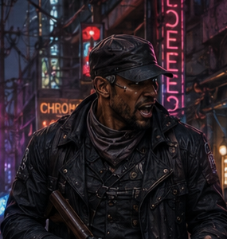

# Kurgan

*Preferred visual reference: the third figure from screen-left in the crew portrait, cropped from the GM-identified left-to-right lineup.*

## Visual Profile (Image-Generation Reference)

- **Metatype / gender:** Human male.
- **Appearance:** Bland-looking and unremarkable.
- **Typical clothing:** Military-style clothes.
- **Signature gear:** A heavy shotgun carried over his back or in his hands; visible chrome.

## Overview

Active player character and the crew's cyber-samurai.

## Known Facts

- Kurgan is played by **Anil**.
- He is a **cyber-samurai**.
- Key crew tags: **Shotgun Expert**, **Disguise Expert**, **Fast-Sam**, **Observant**.
- He is a former member of **Humanis**.
- He is cultivating a relationship with **Mayor Mike Haggar** and **Joseph Neumann** as a possible senior fixer/security figure for the mayor's outside apparatus.
- During the 2066-05-09 interlude, Kurgan and Curtis eliminated **Righteous Haze** for the mayor.
- Kurgan privately kept Haysen's recovered paydata rather than turning it over to the mayor or the rest of the crew.
- Kurgan earned **4 Karma** and **5,000¥ total payout / recovered value** from the Righteous Haze interlude.
- During the Pixel Sticks investigation, Kurgan recognized **Chunky Sparkles** inside Happy Cat and later led the crew's stairwell approach through the Vernon Winfrey arkoblock.
- During the 2026-07-23 21st-floor breach, Kurgan helped shape the deception/hard-entry plan, managed the room-clearing pressure, used a hostile youth as a shield during the escape, and helped the crew get out through the elevator.
- During the 2026-08-06 player-driven follow-up, Kurgan used Glenn and Herrick as fallout contacts, scouted the damaged scorpion drone in South Side Highwaymen territory, maintained the close stakeout, and stayed hidden through the recovery fight.
- During the 2026-08-13 player-driven follow-up, Kurgan remembered the older Chunky Sparkles incident, used Herrick to get Lizzo Wells's command details, guided Valgaut through the Radnor Lake approach, and helped bring down the regenerating gator-like predator.
- During the 2026-08-27 player-driven follow-up, Kurgan helped frame the Pixel Sticks sponsor inquiry for Herrick, checked **Lizzo Wells / Handy-Sandy** with **Kne@zle**, and supported the decision to approach CAT rather than Princeps.
- During the 2026-09-03 Byron Cedar rush job, Kurgan served as Kilimanjaro's crew connection, joined the Belisarius job, kept overwatch near the diner, and suggested **Mucky's** as a plausible shadowrunner-friendly gambling destination.

- At the start of [Session 2026-09-10](../Sessions/2026-09-10.md), Kurgan withdrew from the encounter to preserve plausible deniability around his City Hall connections and retirement ambitions; he did not take part in the closing extraction or chase.
- Kurgan was absent from [Session 2026-09-17](../Sessions/2026-09-17.md), but the new White Creek / Ring of Fire job explicitly touches **Humanis** territory and was noted by the GM as originally written with Kurgan in mind.
- During [Session 2026-10-01](../Sessions/2026-10-01.md), Kurgan rejoined the White Creek operation, helped search and move the Sandusky-labeled records, and killed an unidentified ganger who was choking on the gas. He took the victim's original-run Dukes of Hazzard commemorative medallion; no value or award was recorded.
- During [Session 2026-10-08](../Sessions/2026-10-08.md), Kurgan called Joseph Neumann about the Sandusky material and left the mayor's 55,000¥ offer pending. He also called Glenn for help with the tainted spirit and agreed to follow up about the Hidden Enforcers' response. Kurgan helped resolve the City Hall pod encounter without combat; the acquired gear's final individual allocation is unrecorded. No Karma or payout.
- During [Session 2026-10-22](../Sessions/2026-10-22.md), Kurgan opened combat at initiative 27, held his first action, then asked Kyron in character whether the mage's mana strike had looked effective before committing to the spirit himself. His shotgun bolts registered as Moderate wounds despite the shedim's astral protection and mundane-weapon protection, and **his final all-success pass at target number 2 banished it**. He spent 2 Karma on Curtis's behalf to break Lula Bell Sandusky's lingering compulsion. He then ran down the fleeing guard [Tom Erlichman](../NPCs/Tom-Erlichman.md) in an opposed Athletics contest, won by a single margin, read his Humanis affiliation and genuine horror through Street Etiquette, and chose to knock him out rather than kill him for later questioning. He assigned the guard's provisional name and took the identity to hold. He took 250¥ off the captive and handed it to Curtis, and helped move the possessed corpse into the compound's deep freeze. He pressed Kyron hard on whether banishment was permanent — the player concern that surfaced the thirty-day clock. **+12,000¥, +8 Karma.**

## Karma And Nuyen Ledger

- **Known current Karma:** at least **35 Karma** from currently tracked wiki events, plus any earlier untracked balance.
- **Known current nuyen:** at least **41,583¥** from currently tracked wiki events, plus any prior personal balance not yet reconstructed on this page.
- **2026-06-25 — Righteous Haze interlude:** **+4 Karma**, **+5,000¥** total payout / recovered value.
- **2026-07-19 — Saab Dynamit Sale thank-you cut:** **+1,000¥** from Curtis.
- **2026-07-23 — Pixel Sticks / Military-Grade Utilities Run:** **+7 Karma**, **+15,000¥**.
- **2026-08-06 — Scorpion drone recovery:** **+7 Karma**, no nuyen payout recorded.
- **2026-08-13 — Wyrmwatch / Chunky Sparkles follow-up:** **+4 Karma**, **+5,000¥**.
- **2026-08-27 — Pixel Sticks sponsor follow-up:** **+3,333¥ approximate share** from CAT's **10,000¥** intelligence / utility-sample payment; no Karma recorded.

- **2026-10-22 — Sandusky evidence sale to the mayor's office:** **+8 Karma**, **+12,000¥**, plus **250¥** taken from the captured guard and handed to Curtis toward cleanup and ammunition. Kurgan also spent **2 Karma** in-session on Curtis's behalf to break the compulsion effect; in-session pool use is not an advancement spend. Tracked totals **27 -> 35 Karma** and **29,333¥ -> 41,583¥** (12,000¥ sale share plus 250¥ guard money; the 250¥ was contributed to Curtis, so treat the net personal effect as the 12,000¥ share unless the GM rules otherwise).
- **2026-09-10 — GM all-PC closeout award:** **+5 Karma**, tracked total **22 -> 27**. Kurgan was not recorded as an active participant in the closing session; the GM's explicit all-PC award on 2026-09-11 applies independently of attendance. No nuyen payout was assigned to Kurgan.

## Relationships

- Linked to the crew's high-speed combat role.
- Linked historically to **Humanis**.
- Currently relevant to the [Humanis Evidence Retrieval](../Arcs/Humanis-Evidence-Retrieval.md) because his former Humanis association may become useful or dangerous if he joins the continuation.
- Linked to **[Mayor Mike Haggar](../NPCs/Mayor-Mike-Haggar.md)** and **[Joseph Neumann](../NPCs/Joseph-Neumann.md)** through the Righteous Haze job.

## Relevant Sessions

- 2026-06-25 — partial-party canon interlude with Curtis; solved the mayor's Righteous Haze problem and advanced Kurgan's potential City Hall security/fixer role.
- 2026-07-16 — recognized Chunky Sparkles, assessed the gang-controlled arkoblock approach, carried Curtis up the stairwell, and scouted the crew to the 21st-floor landing.
- 2026-07-23 — led much of the 21st-floor tactical planning and escape posture, helped pressure the surviving Pixel Sticks members, and earned **7 Karma** plus **15,000¥**.
- 2026-08-06 — helped trace the escaped scorpion drone, called Glenn and Herrick for fallout leads, identified South Side Highwaymen territory and tags, scouted the drone on foot, and earned **7 Karma**.
- 2026-08-13 — supported Valgaut's Chunky Sparkles recovery, called Herrick for prisoner-side command intel, used wilderness survival to approach Radnor Lake safely, shot the regenerating predator, and earned **4 Karma** plus **5,000¥**.
- 2026-08-27 — helped drive the Pixel Sticks sponsor follow-up, contacted Kne@zle about Handy-Sandy, and earned an approximate **3,333¥** share from CAT's intelligence payment.
- 2026-09-03 — joined Kilimanjaro's Byron Cedar rush job, provided overwatch, and helped point the team toward Mucky's as the next-stage lure site; no payout or Karma recorded yet.
- 2026-09-17 — absent, but the new Ring of Fire / Humanis job was identified as a natural Kurgan-relevant run; no payout or Karma recorded.
- [2026-10-22](../Sessions/2026-10-22.md) — banished the shedim with the final shotgun pass, broke Curtis's compulsion with Karma, captured the surviving Humanis guard, and helped close out the evidence sale. **+12,000¥, +8 Karma.**

## Sources

- `PARTY_DOSSIER.md`
- [Session 2026-06-25](../Sessions/2026-06-25.md)
- [Session 2026-09-17](../Sessions/2026-09-17.md)
- [Session 2026-10-08](../Sessions/2026-10-08.md)
- [Session 2026-10-22](../Sessions/2026-10-22.md)
