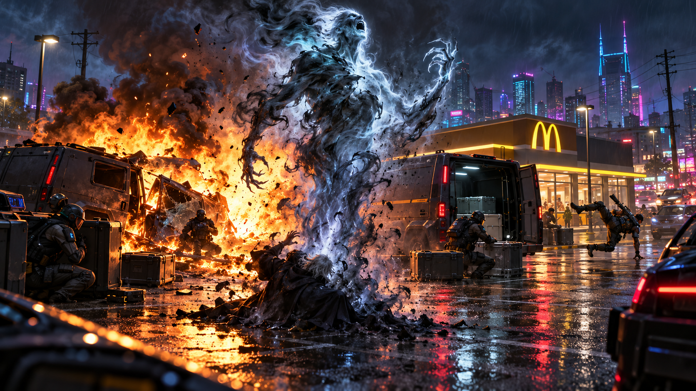

# Session 2026-10-15

## Summary

**The crew tried to deliver the recovered Sandusky evidence to its anonymous Johnson at a public Nashville drop. The meeting turned into a confrontation when Lula Bell Sandusky appeared with armed security, magically compelled Curtis to answer questions about the files, and signaled her guards to kill the team. Kyron's Force 3 fireball devastated the vans; Sandusky's physical body was shattered, and the tainted greater spirit of man that had been inhabiting her emerged. The Johnson handoff and the contract remain unresolved.**

After discussing how to divide the physical evidence, the crew chose to contact the original client before pursuing other interested parties. Curtis routed a call through Buzz at long range to reduce the risk of exposing the team's location. The frantic-sounding male Johnson requested a physical exchange at a McDonald's parking lot, with boxes transferred into a vehicle before payment. Kurgan took an early position inside the restaurant; Buzz and Mevin surveyed the site, including encrypted radio traffic and two conspicuously armored vans. Kilimanjaro and Kyron positioned themselves for overwatch.

The crew recognized Lula Bell Sandusky among the people at the vans. Astral observation showed that she was awakened, apparently able to mask that fact most of the time. During the attempted exchange she cast a spell on Curtis: he was compelled to answer honestly and temporarily did not regard her as an enemy. When Curtis admitted he had inspected the evidence, Sandusky signaled a guard to kill him. The runners moved into combat. Kyron cast a Force 3, Moderate fireball into the group by the vans. The blast wrecked one van and ignited the other; the GM reported two guards dead and one surviving among those caught in the explosion. Mevin was thrown through the McDonald's entrance windows and Curtis was knocked off his feet; Kyron suffered a Moderate Stun wound. Exact post-blast condition and combat resolution remain for next session.

The final scene: Kyron perceived Sandusky's body crumpled and apparently dead, replaced by the tainted greater spirit of man previously believed banished. The session ended as the spirit emerged. No evidence changed hands, no payment was made, and no Karma or other award was recorded.

The GM's supplied table-time estimate was about **8:00-10:00 p.m. Central**. The merged capture spans **8:53-11:04 p.m. Eastern (about 7:53-10:04 p.m. Central Daylight Time)**, including setup/table discussion before and after the in-world action.

## Major Scenes

- **Decision to approach the original Johnson:** The team discussed keeping the original, making copies, and the mayor's and Princeps's potential interest. They agreed to close out the original contract first. Exact copy count and custody are not settled in the transcript.
- **Long-range contact and public drop:** Curtis relayed the burner call through Buzz. The Johnson requested the physical boxes at a public McDonald's parking lot and said the crew would be paid after loading them into a vehicle. No payment terms beyond that sequence were confirmed.
- **Recon and positioning:** The team noted encrypted radio chatter and two up-armored vans. Kurgan blended into the restaurant; Curtis used Buzz for a fly-by; Mevin checked public information and suspicious vehicles; Kilimanjaro moved to a closer vantage; Kyron used astral perception. The crew did not establish who had deployed the vans or whether this was a deliberate double-cross.
- **Sandusky revealed:** The figure near the vans was Lula Bell Sandusky, disguised as a frail older woman. The GM identified her as awakened and likely able to mask her astral presence. Kurgan's Humanis knowledge suggested awakened status did not necessarily mean she was a natural Humanis ally; the truth of her beliefs and past actions remains unresolved.
- **Spell and ambush:** Sandusky used magic to compel Curtis to answer truthfully. After he confirmed examining the files, she gave a throat-cutting signal to a guard. The security force took hostile action; Kyron's fireball caused a major explosion, with the casualties and vehicle damage described above.
- **Tainted spirit returns:** The blast shattered Sandusky's physical form. Kyron saw the tainted greater spirit of man that had been inhabiting her body emerge. The crew has not yet acted against or communicated with it.

## NPCs Introduced / In Play

- **Lula Bell Sandusky** — appeared at the physical handoff, apparently disguised and with armed security. She was awakened, cast a truth-compulsion spell on Curtis, and signaled an attack after learning he had examined the evidence. Her body was apparently killed/shattered in the blast; the tainted greater spirit inhabiting it emerged. Her relationship to the spirit, her knowledge of the evidence, and her exact Humanis ties remain unknown.
- **Anonymous original Johnson** — contacted by burner through Buzz. A frantic male voice arranged a physical public drop and promised payment after transfer. Identity and fate after the interrupted exchange remain unknown.
- **Sandusky's security detail** — several armed personnel accompanied her. The GM reported two dead and one surviving among three guards caught in the explosion; identities, affiliations, and the rest of the detail's status are unknown.
- **The tainted greater spirit of man** — the same entity previously seen above White Creek and reported banished by the Hidden Enforcers; now apparently revealed as having inhabited Sandusky's body. It emerged at the session's endpoint. Whether this is the same spirit, how it returned, and what it intends are open.

## Clues Gained

- Lula Bell Sandusky was physically present at the Johnson's drop and could use magic. Kyron's astral perception caught her awakened signature; a magic-background check suggested she could usually mask it.
- Sandusky's apparent effort to keep the evidence's contents hidden became hostile once she learned Curtis had inspected it. The motive and connection between her and the anonymous Johnson are unknown.
- The two up-armored vans used encrypted radio communications and were positioned with Sandusky's security. The team has not established whether they belonged to the Johnson, Sandusky, or another party.
- The previously banished tainted greater spirit of man emerged from Sandusky's apparently dead body. Its connection to her and the means of its return are unknown.

## Decisions Made

- Contact the original Johnson first and attempt the promised physical handoff before approaching other possible interested parties.
- Use Buzz as a remote relay for the burner call and reconnaissance to limit direct exposure.
- The team attempted the requested public exchange, but the meeting was interrupted by violence. No final disposition plan for originals or copies is established.

## Rewards / Ledgers

- **No Karma, nuyen payout, or job-completion award.** The evidence was not transferred and the Johnson's promised payment did not occur.
- No new gear acquisition was confirmed this session. The armor and weapons acquired in Session 2026-10-08 are tracked separately.
- Combat wounds and vehicle/gear damage were not fully reconciled before play stopped; carry them forward for GM/players to confirm.

## Changes to Campaign State

- The crew remains in Nashville at the McDonald's drop site with the Sandusky evidence still in its custody; the attempted handoff is incomplete.
- Lula Bell Sandusky's physical body appears dead after the explosion, while the tainted greater spirit of man that inhabited her emerged. Do not assume the spirit is Lula's soul or that either entity is permanently destroyed.
- The active run remains unresolved. The original Johnson's identity and payment, the evidence's eventual recipients, and Neumann's outstanding offer are all open.
- The in-world date carries forward provisionally as late May 2066 or later, nighttime. No exact in-world date was spoken.

## Open Threads

- Survive or resolve the re-emerged tainted spirit; determine how it returned after the Hidden Enforcers reportedly banished it and whether it was inhabiting Sandusky.
- Determine Sandusky's fate and whether the physical body is recoverable; establish her motives, magical abilities, and relationship to Humanis and the evidence.
- Resolve combat, injuries, casualties, surviving security, and the condition of Grandpa, the McDonald's, and both vans.
- Re-establish contact with the original Johnson and learn whether the interrupted handoff/payment can proceed safely.
- Decide custody of the original evidence and any copies; determine how the original Johnson, Mayor Haggar/Joseph Neumann, and Princeps may be involved without assuming they are allied.
- Identify who supplied the two armored vans and security detail and whether their presence was coordinated with the Johnson or Sandusky.
- Follow up with Glenn about the Hidden Enforcers' prior banishment report and the spirit's reappearance.
- Continue examining the extra paydata and old terminal recovered from White Creek; confirm what materials the team has copied.

## Sources

- [Discord: Session 2026-10-15](https://discord.com/channels/430878850319253504/718496193377992777/1560455523621666868), Shadowrun channel.
- Original live transcript: `2026-10-15T20-53-08-shadowrun/transcript.jsonl`.
- Recovered gap transcript: `2026-10-16T02-46-00Z_recovery_faster_whisper_base.en/04_transcript_events/recovered_transcript.jsonl` (611 recovered entries for the transcription gap).
- Session illustration: [Sandusky handoff and spirit emergence](../assets/images/Session-2026-10-15-Sandusky-Handoff.png).
- Complete chronological merge: 1,309 transcript entries, 20:53:35-23:04:49 Eastern; combines all 698 live entries with 611 recovered entries, deduplicated by event ID. The provided intermediate merged transcript ended before the live capture's final entries, so the closeout used a complete reconstruction.
- Session scope: approximately **8:00-10:00 p.m. Central**, supplied by the GM; transcript times are Eastern and include table/setup talk around the in-world scene.
- In-world date remains provisional from [Session 2026-10-08](2026-10-08.md); transcript did not establish an exact date.
- Transcript wording was normalized only where the context was clear; ambiguous names, exact copy inventory, and unresolved outcomes are marked as such.
