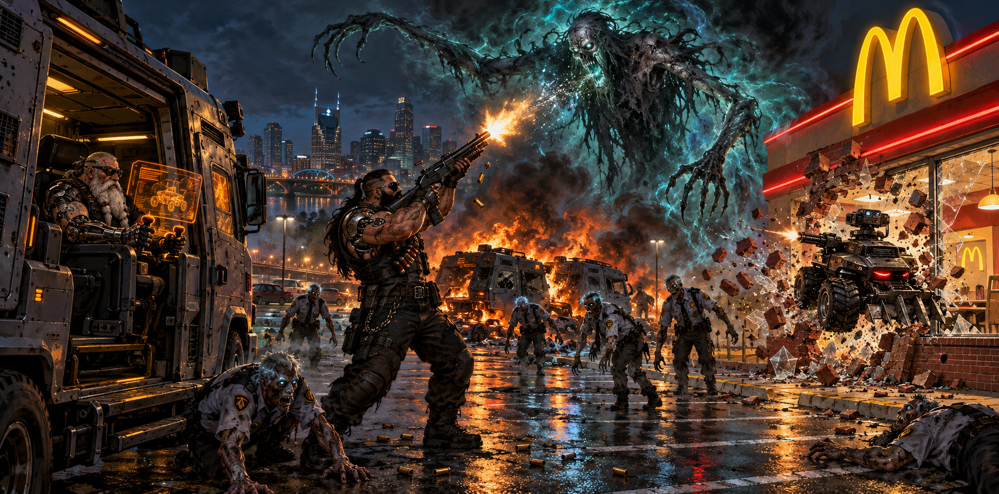

# Session 2026-10-22

## Summary

**The crew survived the McDonald's handoff disaster, banished the spirit released from Lula Bell Sandusky's destroyed body, and closed the evidence-retrieval run with the mayor's office. Kyron identified the entity as a shedim: defeated for one turn of the moon, about thirty days, but not permanently dead. The team escaped with a living guard, Tom Erlichman, and a formerly possessed corpse for study. Buzz's transformation footage joined the evidence copy delivered to the mayor; each runner received 12,000¥ and 8 Karma.**

The fight continued directly from [the previous session](2026-10-15.md). Kilimanjaro's opening burst dropped a guard, and the spirit raised three fallen security men as possessed shamblers. Kyron's Mana Ball, Kurgan's shotgun, and Kilimanjaro's grenade wore down the principal entity. It missed its retaliatory attack, then faded under Kurgan's final shot. One shambler kept attacking Grandpa after its master disappeared; Kyron stopped it separately.

Curtis broke Sandusky's lingering influence, returned to Grandpa's captain's chair, and drove Belmont through the restaurant. The two interior guards fled; he subsequently shot them down with the drone. Kurgan and Kilimanjaro instead captured the surviving outside guard. Mevin found cover and recognized the supervisor's repeated police summons. The team departed before intervention, then Cindy Lou wiped the restaurant recordings.

At Taco's compound, the corpse went into the deep freeze and Tom was restrained for later questioning. Mevin took painkillers for his soreness, not a physical wound. Magical discussion established a possible ritual-link use for the specimen and a permanent solution on the spirit's home metaplane, but left its history and return mechanism speculative. With retaliation not considered an immediate crisis, the crew prioritized payment.

Princeps rejected Mevin's drug-affected sales call. Curtis supported giving the mayor the video both for its value and as a genuine warning. The existing mayor-side deal went ahead without a separately negotiated footage bonus. The confrontation and aftermath run to about 1 a.m.; the exact in-world calendar date remains unstated.

## Major Scenes

- **Voice-bridge triage:** Recap attempts selected the wrong session, playback ran across several clips, semantic transcript search was unavailable, and TTS reported 403. Clint checked the search and Kokoro bridge repairs; the GM restarted voice and ultimately recapped the ambush himself. Curtis's player joined from a Troy, Michigan hotel without usable tabletop access; narration, GM-rolled dice, and Abe's screen sharing supported play. A later invocation briefly rebooted the bridge; Cindy's research answer eventually played at increased speed to fit the requested cap.
- **Initiative and the first casualties:** The order was **Kurgan 27, Kilimanjaro 20, Kyron 9, Curtis 7, Mevin 6**. Kurgan held. Kilimanjaro moved toward the drive-through and killed an outside guard with a burst. The spirit raised that man and the two earlier blast casualties. Kyron initially failed to identify the entity, but assensing showed three dual-natured possessions. Kurgan clarified that his shotgun target was a shambler, not the nearby living guard, and dropped it before taking cover behind Grandpa; possession persisted in the fallen body.
- **Mana, machinery, and cover:** Kyron judged banishing the powerful entity difficult and chose Mana Ball, inflicting a Moderate wound. Curtis's Karma-assisted resistance cleared the foreign thoughts excusing Sandusky's murderous intentions. He deployed Belmont, warned Mevin over subvocals, and drove through a window and the soda machine. Deployment and maneuvering exhausted his actions; firing came later. Both interior guards fled. Mevin passed his Body check against target number 6, including low pain tolerance, and sheltered prone behind the counter with frightened staff. The upright shamblers battered Grandpa without penetrating its armor.
- **Breaking the main spirit:** Kurgan's shot inflicted another Moderate wound despite astral and mundane-weapon protections. Kilimanjaro used the Combat Pool dice he had saved for his underbarrel grenade launcher; the grenade detonated the remaining van, splattered the already-downed shambler, dropped another, and wounded the last. The blast also brought the main spirit to nine of ten damage boxes. It stayed out of rage and hurled black energy at Kilimanjaro, dissolving brick and leaving a stench of decay without hitting him. Kurgan's final shotgun attack forced its banishment. Kyron recognized the departing entity as a shedim and shared the thirty-day exclusion with the team.
- **Three fleeing guards, two different outcomes:** Kurgan won the opposed chase by one success and tackled the outside guard a block or two away; Kilimanjaro followed to help. A successful Street Etiquette read found the Humanis thug's horror genuine. They knocked him out for questioning. Curtis did not retroactively claim nonlethal grenades for Belmont: after its drive through the restaurant, he used its gunfire to cut down the two fleeing interior guards. Mevin declined to intervene. These men were not established as possessed.
- **The last possession and the exit:** Banishment left one shambler punching Grandpa. Kyron sensed no remaining metahuman Essence and used **Power Bolt** to destroy its weak possessing spirit; the body collapsed. Mevin's Police Procedures check revealed the supervisor hammering the PANIC! button. During a quick astral sweep, Kyron learned that the portal exposing the principal entity had closed and fire had probably ruined most magical remains. With Curtis's consent, he put an ex-shambler in Grandpa's underfloor storage. The RV collected the captive and crew and left before police arrived.
- **Salvage with chicken nuggets:** Kurgan requested a twenty-piece order during the escape; Mevin supplied loose floor nuggets instead, prompting arguments about glass and the normal number of hairs. Kilimanjaro was still hungry after spending the evening at McDonald's. Asked about recordings, Mevin did not claim useful footage while flying through the blast, and Grandpa was not always recording. Buzz, still on surveillance, had caught Sandusky's destruction and the monster's emergence. Its roll of a one and a two against target number 2 was the worst possible success. The team added the video to its evidence.
- **Cleanup and containment:** Kurgan asked Mevin to erase the restaurant footage; Mevin delegated to CLJ. The GM called for Computer against target number 4 and declared the wipe successful. The crew chose Taco's compound over forcing an immediate sale. Behind the rundown gas station, Curtis's existing dolphin-and-seal habitat supplied a calmer backdrop to corpse storage and prisoner restraint. Kyron's specimen went into the deep freeze. Tom was chained to a chair, gagged, and hooded. Memories of an earlier frozen horse remained table recollections, not a newly identified specimen.
- **Research reaches its limit:** Failed Magic Background checks could not establish whether Sandusky had been an ordinary person taken over; a critical failure informed the belief that she might return looking unchanged. Later successful checks supplied firmer guidance about home-metaplane destruction; Magic Background against target number 6, with two successes, established dead-body possession and the spirit's limited ability to identify attackers. The GM explicitly left identity and shell-recreation theories speculative. A magical-research contact and a final Wolf-themed lodge insight were offered, not used. Cindy's later voice answer informed discussion, and the GM's practical recap was that the problem was not pressing immediately.
- **Buyer selection and closeout:** Mevin called the crew's existing Princeps contact using a burner. Painkillers raised Corporate Etiquette targets from **5/10 to 6/11**; Friendly Face did not apply over the phone, and he failed. The contact denied knowledge and showed hostility toward paying for material Princeps expected free. Curtis's Electronics roll supported confidence that the signal was anonymized. The crew chose the mayor's existing offer, included Buzz's footage despite possible self-implication, and received payment and Karma. The GM saved the tabletop and proposed **Thursday, October 29** for the next session; Curtis expected to remain remote.

## NPCs Introduced / In Play

- **[Lula Bell Sandusky / the shedim](../NPCs/Lula-Bell-Sandusky-The-Face-Beneath-the-Face.md):** Her public body was destroyed before initiative resumed. The released entity raised guards, fought, and was banished, not permanently killed.
- **[Tom Erlichman](../NPCs/Tom-Erlichman.md):** Captured Humanis private security, lightly chromed and well dressed rather than a hardened combat professional. He is a city resident with a system ID. Kurgan retained his identification for possible future use; no impersonation occurred.
- **Sandusky's other guards:** Three fallen men became possessed hosts and were neutralized; one corpse was recovered. Two separate living interior guards were killed by Belmont. Staff and civilians witnessed the disaster; no civilian casualty total was established.
- **[Joseph Neumann](../NPCs/Joseph-Neumann.md) and [Mayor Mike Haggar](../NPCs/Mayor-Mike-Haggar.md):** Neumann was the negotiating contact; the GM resolved the final transaction as a meeting with the mayor. They are distinct people on the buyer's side.
- **[Cindy Lou Jenkins](../NPCs/Cindy-Lou-Jenkins.md):** Credited with the restaurant-host wipe and consulted for Matrix research. The flattened capture contains discussion of her spoken research, not its full text.
- **Eric, [Glenn](../NPCs/Glenn.md), and the Hidden Enforcers:** Discussed as existing police/magical relationships, not contacted during this session. The unnamed Princeps contact was reached and refused the sale.

## Clues Gained

- **Shedim, not a spirit of man:** Kyron's successful identification superseded the earlier working label. The GM cited the SR3 supplement *Year of the Comet*: shedim appeared recently enough in-world to remain poorly understood.
- **A banishment buys time:** The encounter ruling prevents return for one turn of the moon, about thirty days. Kyron could not predict a return location. Reliable permanent destruction requires confronting the spirit on its home metaplane; bringing mundane companions through would require complex access beyond present means. A Grandpa-sized portal was a question, not an acquired capability.
- **The tear enabled the encounter:** The GM explained that Sandusky's destruction opened the temporary astral portal through which the mundane runners could perceive and attack the entity. It sealed when the entity was banished.
- **The specimen offers a possible ritual link:** The GM described shedim investing/budding part of themselves into corpses. Such remains might permit backtracing or another advantage against the higher-level entity. No ritual, anchor identification, or successful trace was performed.
- **Retaliation is not automatic:** The GM emphasized that spirits are not omniscient; without a ritual link, this one might know only that unidentified runners attacked it. This supported postponing pursuit, not certainty that the crew was safe forever.
- **Evidence of ignorance and exposure:** Tom's shock appeared sincere, but his testimony is still untapped. Buzz's distant recording proves the transformation occurred; its coverage of the attackers was not forensically established. Erasing the restaurant's recordings did not erase witnesses or every possible outside camera.

## Decisions Made

- Damage the principal entity rather than attempt difficult banishment; Kurgan kept his familiar shotgun instead of field-testing the experimental one.
- Capture Tom alive; Curtis separately chose lethal gunfire against the fleeing interior guards.
- Leave before police intervention rather than spend goodwill explaining the scene; delegate the restaurant wipe to Cindy.
- Preserve Buzz's footage and one former host body, with Curtis's express consent to transport the corpse; regroup, freeze the specimen, and secure the prisoner.
- Try Princeps, then accept the mayor-side deal after refusal. Include the video to warn the mayor as well as strengthen the package.
- Defer metaplanar pursuit. Kurgan suggested operating on the theory that the spirit and Sandusky were effectively the same; that working assumption did not settle her origin.

## Rewards / Ledgers

- **Run payment:** Curtis, Mevin, Kurgan, Kilimanjaro, and Kyron each received **12,000¥**: **5 × 12,000¥ = 60,000¥**. The GM recalled the mayor-side agreement at that total. Neumann's earlier **55,000¥** offer and the original contract's **60,000¥** quotation are background, not additional payouts. Kilimanjaro's “price just went up” did not become a separately negotiated video bonus.
- **Karma:** **8 per character; 5 × 8 = 40 Karma awarded across the five runners.** Curtis spent **2 Karma Pool** on his resistance check, and the GM added **2** more: **2 + 2 = 4** assistance. Pool use is not deducted from advancement Karma.
- **Curtis's ledger reconciliation:** The existing baseline gives **19 + 8 = 27 Karma** and **7,503.33¥ + 12,000¥ = 19,503.33¥** from the award alone. Kurgan handed Tom's credstick to Curtis for cleanup and ammunition; **250¥ is booked**, giving **19,503.33¥ + 250¥ = 19,753.33¥** before unpriced expenses. **[unverified]** The capture says “250 million,” treated as a transcription garble rather than that denomination.
- **Conditions and supplies:** The GM clarified that Mevin took no physical wound; he roleplayed soreness and used available painkillers. No drug cost, new Grandpa/drone damage, repair bill, or exact ammunition expenditure was assigned. The missed black bolt did not wound Kilimanjaro. No drain/condition reconciliation was recorded.
- **Character-transition money:** The GM accepted Kilimanjaro's proposed cash-for-a-successor idea, but no hiding place, replacement character, or completed transfer was established. His award remains his single share. Kurgan's eventual fixer/retirement path likewise was not enacted.

## Changes to Campaign State

- The Humanis evidence-retrieval run is paid and closed through the mayor's office. The mayor received **a copy** of the evidence and the new video, not an explicitly inventoried surrender of every original.
- The McDonald's confrontation is over: the main shedim is temporarily banished, all three possessed guards are neutralized, and the restaurant and vans are wrecked. Kurgan's initial guard target was already possessed, not another living guard execution.
- Taco's compound holds an un-interrogated living witness and a frozen former host. Neither has yet supplied the entity's history or prevented its eventual return.
- Princeps remains hostile. The crew's city ties were reaffirmed: Eric's working relationship, Mevin's **limited** police-network access, Glenn's Hidden Enforcers association, and Kurgan's developing mayor-office fixer role.
- The timeline remains late May 2066 or later, with this confrontation and aftermath placed around 1 a.m.; no following-morning advance was announced.

## Open Threads

- **Tom:** Question him about Sandusky's behavior, security arrangements, contacts, and any change in demeanor; decide his disposition.
- **Spirit and research:** Resolve Sandusky's prior personhood, shell recreation, motive, return location, and any attachment holding the entity here. Test the specimen's ritual-link potential; choose a magical researcher/contact or claim the offered Wolf-lodge insight, after which the GM specified exhaustion.
- **Longer-term response:** Decide whether to pursue permanent destruction, and how mundane teammates or Grandpa could accompany a metaplanar expedition.
- **Evidence custody:** Inventory the originals and retained copies after the mayor's copy, plus the concealed paydata and Mevin's old terminal. The original Johnson remains unidentified; this sale did not resolve that arrangement.
- **Consequences and older leads:** Police/public response, Princeps hostility, White Creek's aftermath, Paul Hardcastle, the Ring of Fire, and the escaped ganger remain open. Follow up with Glenn about the Hidden Enforcers' earlier banishment and any response costs, without assuming every earlier identification has been proved correct.

## Sources

- [Discord session thread](https://discord.com/channels/430878850319253504/718496193377992777/1562991889681088612); live capture `2026-10-22T20-51-45-shadowrun`.
- Primary evidence: archived flattened transcript `/Volumes/carbonite/claw/data/cindylou/session-archives/2026-10-22/s20261022.txt`, read fully: **1,196 lines**, **20:52:16–23:02:16 Eastern**. Timestamps include setup and wrap; the GM's supplied table-time estimate was about **8–10 p.m. Central**.
- GM rulings settle the Karma Pool spend, Tom's name, spell/outcome treatment, Belmont's breach followed by the shootings, and the approximate **1 a.m.** in-world hour.
- **Carry-over from prior sessions:** [September 24](2026-09-24.md), [October 1](2026-10-01.md), [October 8](2026-10-08.md), and [October 15](2026-10-15.md) establish White Creek/Hardcastle/Ring of Fire, the escaped ganger, paydata/terminal, earlier offers, Glenn's reported banishment, date continuity, and the confrontation's starting state. [Curtis's existing ledger](../PCs/Curtis.md) supplies the baseline balances; these are continuity inputs, not newly spoken totals.
- *Year of the Comet* was cited by the GM in-session. Encounter-specific rulings above describe this table's resolution; player theories and unplayed research options remain distinct from established results.
- **Generation history:** this record supersedes the original gpt-6-luna version and the independent blind gpt-6.1-sol version. The blind alternate is retained at [Session 2026-10-22 (Alternate Summary)](2026-10-22-Sol-Alternate.md); the gpt-6-luna original is preserved in this repository's history for commit `12976e4`.
